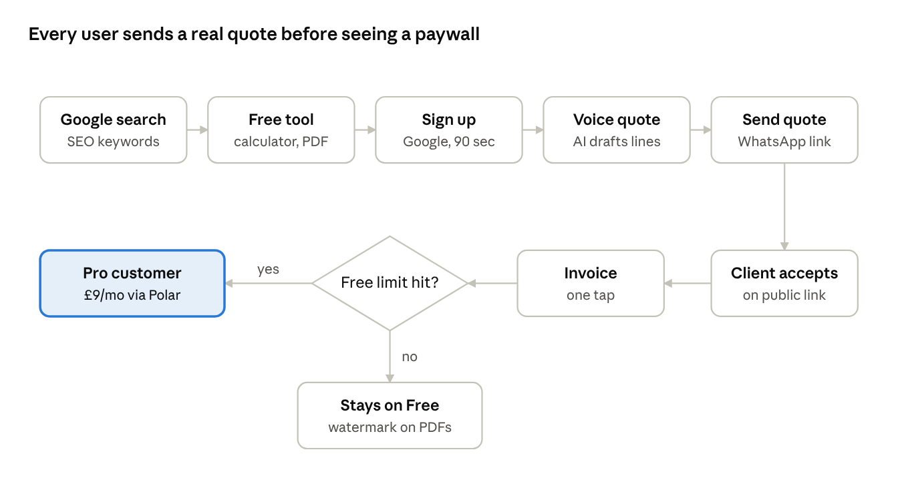
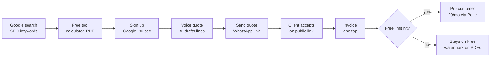
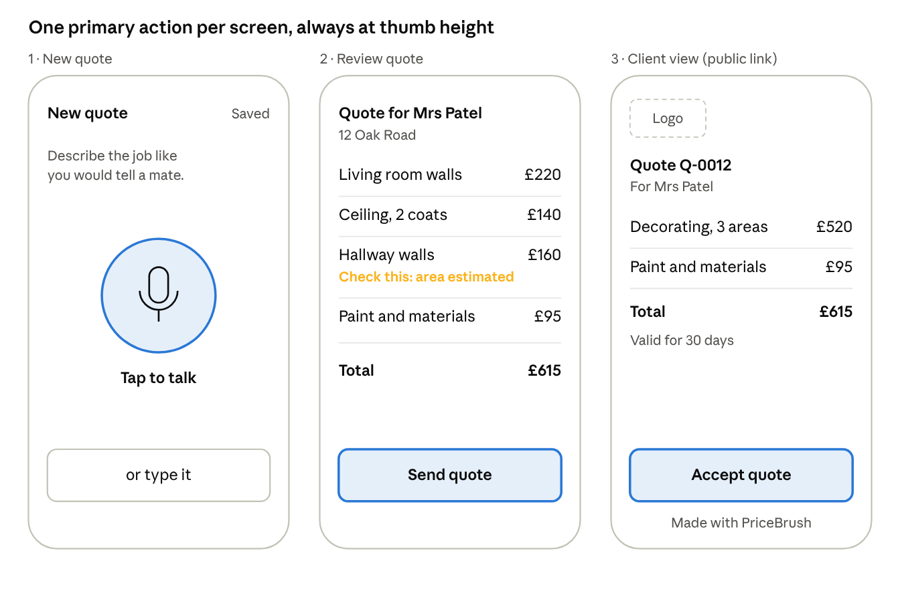
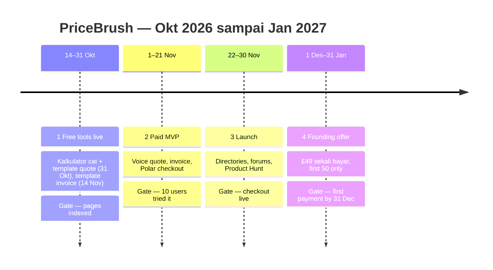

# PriceBrush — PRD, UX & User Flow (v0.2)

Tanggal: 14 Oktober 2026 · Diperbarui: 17 Oktober 2026 (keputusan CEO, lihat `docs/ceo/decisions-2026-10-17.md`) · Gambar diagram & mock-up: [`docs/assets/`](assets/)

---

## 1. Ringkasan produk

PriceBrush membantu decorator solo di UK membuat penawaran (quote) profesional dengan hitungan khas decorator (ruangan → lapisan → liter cat → hari kerja → harga dari day rate sendiri), dari HP maupun laptop, lalu menjadikannya invoice begitu quote diterima. Target bisnis: 1–5 pelanggan berbayar pertama (total £40–250) sebelum 31 Desember 2026.

**Masalah** (dari riset review app dan Reddit UK):

- Quote dan invoice dikerjakan malam atau weekend, setelah seharian kerja di lapangan.
- Template Word terlihat tidak profesional dan bisa membuat kalah tender.
- App yang ada mahal per user (Tradify ~£34/user/bulan), ribet untuk tukang solo, sering crash, dan agresif dengan sales call.
- Menghitung harga pekerjaan cat (luas, jumlah lapis, liter cat, hari kerja) masih manual.

**Solusi:** tukang menjelaskan pekerjaan dengan suara atau form singkat. AI menyusun quote per item (ruangan, permukaan, material, tenaga) yang bisa diedit. Quote dikirim sebagai link atau PDF lewat WhatsApp atau email, lalu diubah menjadi invoice dengan satu tap.

**Target user:** painter & decorator di UK, kerja sendiri atau berdua, mayoritas kerja dari HP.

**Positioning (17 Okt 2026):** "The UK decorator's quote app that does the maths: rooms to paint, days and price. No per-user fees. No sales calls. Cancel in one tap."

**Pembeda utama:** hitungan decorator yang terlihat dan bisa dicek di dalam quote (m², lapisan, liter, hari, upah dari day rate), dan bisa dicoba di kalkulator gratis sebelum daftar. Klaim "60 seconds" dan "quote → invoice in one tap" **tidak dipakai** karena sudah dimiliki kompetitor (QuoteRocket, TradeQuoteAI).

**Alternatif yang kita lawan:** Word/Excel dan WhatsApp, Tradify, Powered Now, Joist, Invoice2go, Jobber, app khusus decorator (Queezy £8,99, PainterPal, Paint Manager), tool quote/invoice gratis (QuoteRocket, InvoiceJob), dan app AI quote (Fixxa, TradeQuoteAI, VoxTrade, Kvota, Sleepless Tradesman). Detail: `docs/strategy/competitors.md`.

---

## 2. Persona & jobs-to-be-done

Persona utama MVP adalah Dave; Sophie jadi target upgrade berikutnya. Keduanya hipotesis dan perlu dicek ke 5–10 decorator sungguhan.

| | Dave (persona utama) | Sophie (persona kedua) |
| --- | --- | --- |
| Profil | 45 th, decorator solo, 20 th pengalaman | 32 th, usaha decorating berdua |
| HP | Android, layar retak, sinyal sering lemah | iPhone, aktif di Instagram |
| VAT | Belum terdaftar (omzet di bawah £90.000) | Terdaftar VAT |
| Cara quote sekarang | Template Word, dikerjakan Minggu malam | Excel + PDF, kadang pakai app gratis |
| Sakit utama | Waktu dan quote terlihat amatir | Klien lama membalas, invoice telat dibayar |
| Yang membuatnya bayar | Hemat 3–4 jam per minggu | Terlihat profesional, quote cepat diterima |

**Jobs-to-be-done:**

1. "Saat saya baru selesai survei rumah klien, saya ingin mengirim quote sebelum pulang, supaya klien tidak keburu menghubungi decorator lain."
2. "Saat menghitung pekerjaan, saya ingin tahu kebutuhan cat dan hari kerja dengan cepat, supaya harga saya tidak rugi."
3. "Saat pekerjaan selesai, saya ingin mengirim invoice dari quote yang sama dalam satu tap, supaya dibayar lebih cepat."

**Konteks pemakaian yang memengaruhi desain:**

- Dipakai di lokasi kerja: tangan kotor atau pakai sarung tangan, jadi input suara dan tombol besar.
- Sinyal tidak stabil: draft harus tersimpan di HP dan tidak boleh hilang.
- Klien di UK berkomunikasi lewat WhatsApp: berbagi lewat link lebih penting daripada email.

---

## 3. Scope MVP (rilis berbayar akhir November 2026)

MVP hanya melayani satu pekerjaan: quote dari HP, lalu jadikan invoice. Semua yang tidak membantu pembayaran pertama sebelum Desember ditunda.

| Fitur | Prioritas | Catatan |
| --- | --- | --- |
| Kalkulator cat & biaya (tool SEO gratis) — beberapa ruangan, dinding/plafon/kayu, day rate → hari → upah → harga, opsi mist coat, tombol "Turn this into a quote" | P0 | Tanpa login, jalan di browser. Andalan launch 31 Okt |
| Generator quote gratis (tool SEO) | P0 | Tanpa login, PDF ber-watermark, bisa diisi otomatis dari kalkulator. Live 31 Okt |
| Generator invoice gratis (tool SEO) | P0 | Tanpa login, memakai ulang PDF quote. Live 14 Nov |
| Login dengan Google | P0 | Tanpa email sendiri: belum punya domain |
| Profil bisnis (nama, logo, alamat, VAT number opsional) | P0 | Sekali isi saat onboarding |
| Quote dari suara atau teks dengan AI | P0 | Hasil selalu bisa diedit per baris |
| Editor quote (baris item, VAT, diskon, catatan) | P0 | |
| Bagikan quote: link publik + PDF | P0 | Tombol share WhatsApp |
| Ubah quote menjadi invoice | P0 | Satu tap, nomor invoice otomatis |
| Daftar quote & invoice dengan status | P0 | Draft, Sent, Accepted, Overdue, Paid |
| Invoice Overdue + tombol "Send a reminder" via WhatsApp | P1 | Teks sopan yang sudah terisi; **dipotong duluan** kalau jadwal telat |
| Batas paket Free + checkout Pro (Polar) | P0 | |
| Klien menekan "Accept quote" di link | P1 | Status otomatis jadi Accepted |
| Price book (day rate, harga cat per liter) | P1 | Dipakai AI saat menghitung |
| Simpan draft saat offline + install PWA | P1 | |
| Duplikasi quote | P1 | |

**Di luar scope MVP (masuk Q1 2027 atau nanti):** baris deposit/DP saat quote diterima, reminder pembayaran otomatis, warna brand sendiri untuk Pro (dengan cek kontras otomatis), app native iOS/Android, backend Go, MTD/HMRC, menerima pembayaran kartu dari klien, multi-user, CIS, jadwal kerja, pembukuan, integrasi akuntansi, profesi selain decorator.

**Prinsip produk:**

1. Quote pertama terkirim dalam waktu di bawah 3 menit sejak daftar.
2. AI menyarankan, tukang yang memutuskan: setiap angka bisa diedit.
3. Tidak pernah kehilangan pekerjaan: autosave setiap perubahan.
4. Harga jujur: tanpa biaya per user, tanpa sales call, cancel satu tap, export data gratis.

---

## 4. User flow

Semua user masuk lewat tool gratis dari Google, lalu dibawa ke satu momen "aha": quote pertama yang terkirim. Paywall baru muncul setelah user merasakan manfaatnya.





**Flow A — Tool gratis (SEO, tanpa login)**

1. User mencari "painting quote template UK" atau "how much paint for a room" dan mendarat di halaman tool.
2. Isi ukuran ruangan atau baris item, lalu lihat hasil langsung (liter cat, hari kerja, total).
3. Download PDF ber-watermark "Made with PriceBrush".
4. Tombol utama di hasil: **"Turn this into a quote"** membuka `/decorating-quote-template` yang sudah terisi, satu baris per ruangan dan permukaan beserta hitungannya (contoh: "Living room walls · 2 coats · 38 m² · 0.8 day — £160.00"). Setelah MVP berbayar live, ada ajakan lanjutan ke Flow B.

**Flow B — Daftar & onboarding (target di bawah 90 detik)**

1. Tap "Continue with Google".
2. Isi nama bisnis dan kota (wajib); logo, VAT number, dan detail bank (opsional, bisa nanti).
3. Isi day rate default (contoh £200/hari). Dipakai AI untuk menghitung tenaga kerja.
4. Langsung masuk ke layar "New quote", bukan dashboard kosong.

**Flow C — Quote pakai suara (inti produk)**

1. Tap tombol mikrofon besar lalu bicara, contoh: "Living room and hallway, walls and ceiling, two coats, magnolia, fill some cracks, client is Mrs Patel, 12 Oak Road."
2. AI mengubah suara jadi teks lalu menyusun quote: baris per ruangan dan permukaan, material, tenaga kerja, VAT jika terdaftar.
3. User meninjau. Baris yang kurang yakin ditandai "check this" (misalnya luas ruangan diperkirakan).
4. Edit angka dengan tap, atau tambah baris.
5. Tap "Send": pilih WhatsApp, email, atau salin link. Status menjadi Sent.
6. Gagal transkrip atau tanpa sinyal: fallback ke form teks; draft tetap tersimpan.

**Flow D — Klien menerima (P1)**

1. Klien membuka link di HP: quote rapi dengan logo tukang, tanpa perlu login.
2. Klien tap "Accept quote" dan mengetik nama. Tukang mendapat notifikasi di app.

**Flow E — Quote menjadi invoice**

1. Di quote yang Accepted, tap "Turn into invoice".
2. Nomor invoice, tanggal, tanggal jatuh tempo (default 14 hari), dan detail bank diisi otomatis.
3. Kirim lewat cara yang sama. Tandai "Paid" secara manual saat uang masuk.

**Flow F — Upgrade ke Pro**

1. Pemicu: dokumen ke-6 dalam sebulan, atau tap "Remove watermark".
2. Layar paket: Free vs Pro, harga jelas, "Cancel anytime in one tap".
3. Checkout Polar di halaman web. Setelah sukses, kembali ke app dan batas langsung hilang.

---

## 5. Requirements fungsional

Setiap fitur P0 dianggap selesai hanya jika semua acceptance criteria di bawah lolos di HP Android murah (layar 360 px) dan iPhone.

| ID | Requirement | Acceptance criteria |
| --- | --- | --- |
| F1 | Kalkulator cat | Input panjang × lebar × tinggi per ruangan, jumlah pintu/jendela, jumlah lapis; "+ Add another room"; switch dinding / plafon / kayu; switch "New plaster? Add a mist coat" (tambah satu lapis sebagai baris sendiri). Output liter cat (default 12 m²/liter, bisa diubah) dibulatkan ke ukuran kaleng, hari kerja, upah dari day rate, dan total berlabel "Your price at your day rate". Hasil muncul tanpa reload. Tombol "Turn this into a quote" mengisi F2 |
| F2 | Generator quote gratis | Isi baris item dan data bisnis tanpa login, download PDF format UK (£, VAT opsional, tanggal DD/MM/YYYY) dengan watermark |
| F3 | Login Google | Login berhasil dalam 2 tap. Sesi bertahan 30 hari |
| F4 | Profil bisnis | Nama dan kota wajib; logo (PNG/JPG maks 1 MB), alamat, VAT number, detail bank opsional. Muncul di semua PDF |
| F5 | Quote dari suara | Rekaman maks 2 menit. Transkrip tampil dan bisa diedit sebelum diproses. Quote terbentuk dalam 15 detik atau kurang. Baris yang diperkirakan ditandai "check this" |
| F6 | Quote dari teks | Kotak teks yang sama dengan F5 sebagai fallback tanpa mikrofon |
| F7 | Editor quote | Tambah, hapus, ubah baris; subtotal, VAT 20% (jika terdaftar), total terhitung otomatis. Autosave tiap perubahan |
| F8 | Bagikan | Link publik unik (tidak bisa ditebak) + PDF. Tombol WhatsApp membuka chat dengan teks dan link terisi |
| F9 | Quote ke invoice | Satu tap membuat invoice dengan baris yang sama, nomor berurutan (INV-0001), jatuh tempo default 14 hari |
| F10 | Daftar dokumen | Filter status Draft, Sent, Accepted, Overdue, Paid. Cari nama klien. (P1) Invoice Overdue punya tombol "Send a reminder" yang membuka WhatsApp dengan teks sopan terisi |
| F11 | Batas Free | Maksimal 5 dokumen per bulan kalender, watermark di PDF dan link. Dokumen ke-6 memunculkan layar upgrade |
| F12 | Checkout Pro | Checkout Polar (pajak di-set **Inclusive**); webhook mengaktifkan Pro dalam 1 menit atau kurang. Cancel = satu tap (berlaku di akhir periode), lalu toast "Cancelled. You keep Pro until DD/MM/YYYY. [Undo]" dan tombol "Resume Pro" sampai tanggal itu. Tanpa penawaran retensi. Kalau Undo ternyata > ~1 jam kerja tambahan, ganti semua klaim jadi "Cancel in two taps. No phone call." |
| F13 | Export & hapus data | Export semua quote/invoice ke CSV. Hapus akun menghapus seluruh data |

---

## 6. UI/UX

Aplikasi dirancang untuk satu tangan, di lokasi kerja, dengan sinyal lemah. Satu layar = satu keputusan.

**Prinsip desain:**

1. Mobile-first di lebar 360 px, **tapi desktop adalah pengalaman kelas satu** (diputuskan 15 Okt 2026): banyak tukang menyelesaikan quote dan invoice di rumah pakai laptop, dan halaman SEO juga banyak dibuka dari desktop. Layar utama (Quotes, Review/edit quote, Invoice, Settings, landing, kalkulator) punya layout desktop sendiri di ≥ 1024 px, misalnya daftar + detail berdampingan, editor quote dengan preview dokumen di samping, dan dukungan keyboard. Input suara tetap ada di desktop (mikrofon laptop), dengan mengetik sebagai alternatif yang setara.
2. Area tap minimal 48 px; tombol utama selalu di bawah, dalam jangkauan jempol.
3. Teks minimal 16 px, kontras tinggi (WCAG AA): dipakai di luar ruangan.
4. Satu aksi utama per layar, warna aksen hanya untuk aksi itu.
5. Status selalu terlihat: "Saved", "Offline — will sync", "Sent".
6. Bahasa sederhana khas UK: "quote", "job", "day rate", "VAT"; bukan "estimate entity".

**Struktur layar (navigasi bawah, 3 tab):**

| Tab / layar | Isi | Aksi utama |
| --- | --- | --- |
| Quotes (home) | Daftar quote & invoice dengan chip status | Tombol "+ New quote" |
| New quote | Mikrofon besar + "or type it" | Rekam / kirim teks |
| Review quote | Klien, baris item, total, tanda "check this" | "Send quote" |
| Send sheet | WhatsApp, email, salin link, download PDF | Pilih saluran |
| Quote publik (klien) | Logo, rincian, total, syarat | "Accept quote" (P1) |
| Invoice | Sama dengan quote + nomor, jatuh tempo, bank | "Send invoice" / "Mark as paid" |
| Settings | Profil bisnis, day rate, harga cat, paket | "Upgrade" / "Cancel plan" |

**Copy kunci:**

- Baris kecil di atas headline: "Quote and invoice app for UK painters and decorators"
- Landing H1: **"Room sizes in. Priced quote out."** (dipakai sampai fitur suara live; diuji ulang vs "Say the rooms. Get a priced quote." akhir November)
- Sub: "Coats, litres, days and labour worked out from your day rate. Every number shown, every line yours to change. Made for UK decorators."
- CTA sebelum MVP: "Price a room free" → `/paint-calculator`. Setelah MVP: "Start a free quote".
- Pengganti klaim "quote → invoice in one tap": "When it's accepted, it's an invoice."
- Janji: "No per-user fees. No sales calls. Cancel in one tap." (jangan pernah "cheaper"/"cheapest"; Queezy £8,99)
- WhatsApp: logo resmi tanpa modifikasi + kata "WhatsApp", tidak dipakai sebagai kata kerja ("Message Dave on WhatsApp"), tanpa klaim partner; pakai ikon chat biasa kalau logo tidak bisa dipakai utuh di tombol kuning.
- Layar New quote: "Describe the job like you'd tell a mate."
- Tanda AI: "Check this — we estimated the wall area."
- Batas Free: "You've used 5 free documents this month. Go Pro for £9/month — cancel anytime."

**Mock-up 3 layar inti** (angka hanya contoh):



Versi teks:

```text
1 · New quote            2 · Review quote               3 · Client view (public link)
┌────────────────────┐   ┌──────────────────────────┐   ┌──────────────────────────┐
│ New quote    Saved │   │ Quote for Mrs Patel      │   │ [Logo]                   │
│ Describe the job   │   │ 12 Oak Road              │   │ Quote Q-0012             │
│ like you would     │   │ Living room walls  £220  │   │ For Mrs Patel            │
│ tell a mate.       │   │ Ceiling, 2 coats   £140  │   │ Decorating, 3 areas £520 │
│                    │   │ Hallway walls      £160  │   │ Paint and materials  £95 │
│       ( 🎤 )       │   │  Check this: area est.   │   │ Total               £615 │
│    Tap to talk     │   │ Paint and materials £95  │   │ Valid for 30 days        │
│                    │   │ Total              £615  │   │                          │
│ [   or type it   ] │   │ [     Send quote     ]   │   │ [    Accept quote    ]   │
└────────────────────┘   └──────────────────────────┘   │   Made with PriceBrush   │
                                                        └──────────────────────────┘
```

---

## 7. Pricing & monetisasi

Satu harga flat tanpa biaya per user, ditambah penawaran Founding Member untuk mendapat uang pertama di Desember.

| Paket | Harga | Isi |
| --- | --- | --- |
| Free | £0 | 5 dokumen (quote + invoice) per bulan, watermark "Made with PriceBrush", semua fitur AI |
| Pro bulanan | £9/bulan incl. VAT | Dokumen tanpa batas, tanpa watermark, logo sendiri (warna brand menyusul), price book |
| Pro tahunan | £79/tahun incl. VAT | Sama dengan Pro, hemat ~27% |
| Founding Member | £49 sekali bayar incl. VAT | "Pro for as long as PriceBrush runs", terbatas 50 orang, berlaku sampai 31 Jan 2027. Kalau PriceBrush tutup: pemberitahuan 60 hari + export CSV |

- Pembayaran lewat Polar sebagai merchant of record: mereka yang memungut dan menyetor VAT UK. Harga ditampilkan **termasuk VAT**; di dashboard Polar pajak di-set **Inclusive** (bukan Location-based). Estimasi bersih: ~£6,50 dari £9, ~£37 dari £49 (fee 5% + 50¢ + 1,5% kartu non-US).
- Biaya AI per quote diperkirakan jauh di bawah £0,01, jadi paket seumur hidup tetap aman secara margin.
- Watermark di paket Free sekaligus jadi kanal marketing: klien si tukang ikut melihat nama PriceBrush.
- Pembeli Founding Member diminta feedback dan satu review di Capterra atau Trustpilot.
- **Diputuskan (15 Okt 2026):** Founding Member £49 sekali bayar, seumur hidup, 50 orang.

---

## 8. Non-functional, privasi & stack $0

Seluruh MVP berjalan di free tier, dengan biaya Rp0 sampai pembayaran pertama.

**Non-functional:**

- Halaman tool SEO dimuat dalam waktu di bawah 2 detik di 4G (Lighthouse ≥ 90), karena kecepatan ikut menentukan ranking.
- Quote dari suara selesai dalam 15 detik atau kurang; jika lebih lama, tampilkan progres.
- Autosave lokal (IndexedDB) setiap perubahan; sinkron ke server saat online.
- Aksesibilitas WCAG 2.2 AA di halaman web.

**Data & privasi (UK GDPR):**

- Simpan data seminimal mungkin: profil bisnis, klien (nama, alamat, email/telepon opsional), dokumen.
- Rekaman suara tidak disimpan; hanya transkrip.
- Tool gratis berjalan sepenuhnya di browser, tanpa menyimpan data ke server.
- Privacy policy dan terms wajib ada sebelum checkout dibuka.
- Link quote publik memakai token acak yang panjang dan bisa dicabut.

**Stack:**

| Lapisan | Pilihan | Biaya |
| --- | --- | --- |
| Frontend & halaman SEO | React + Vite + TypeScript + Tailwind CSS, PWA, pnpm | $0 |
| Hosting | Cloudflare Pages (pricebrush.pages.dev) | $0 |
| API kecil & kunci rahasia | Cloudflare Workers | $0 (free tier) |
| Database | Neon (serverless Postgres) free tier | $0 |
| Login Google & simpan logo | Belum dipilih: Neon cuma database, jadi auth dan file storage perlu solusi terpisah (ditentukan di system design Lead) | $0 |
| Suara ke teks | Groq Whisper free tier; cadangan kredit Deepgram | $0 |
| AI penyusun quote | LLM murah via API (free tier atau kredit awal) | $0 di awal |
| PDF | Dibuat di browser (react-pdf) | $0 |
| Pembayaran | Polar (potongan per transaksi saja) | $0 di depan |
| Analytics & SEO | Cloudflare Web Analytics + Google Search Console | $0 |

Backend Go masuk Q1 2027 untuk fitur MTD dan sinkronisasi, bukan untuk MVP.

---

## 9. Metrik sukses, kriteria stop & timeline

Ukuran sukses pertama: minimal 1 pembayaran sebelum 31 Desember 2026. Target lain di bawah adalah estimasi (diubah 17 Okt 2026) dan diganti dengan angka nyata di **checkpoint 15 Des 2026**. Pembayaran pertama kemungkinan besar datang dari minggu launch (direktori, forum, Product Hunt) dan penawaran Founding Member, bukan dari SEO saja.

| Metrik | Target 31 Des 2026 | Cara ukur |
| --- | --- | --- |
| Halaman terindeks Google | ≥ 10 | Search Console |
| Pemakaian tool gratis (`calc_used` + `pdf_downloaded`) | ≥ 500 | Event counter anonim, **dihitung mulai 08/11/2026**; 31/10–08/11 pakai page views Cloudflare Web Analytics |
| Akun terdaftar (dengan `signup_source`) | ≥ 10 | Database (Neon) |
| Aktivasi: quote pertama terkirim dalam 24 jam | ≥ 4 akun (≈ 40%) | Event "quote_sent" |
| Pembayaran (Founding/Pro) | ≥ 1 (ideal 5) | Dashboard Polar |

**Kriteria stop atau pivot (evaluasi 30 April 2027):** jika trafik organik tidak naik selama 3 bulan berturut-turut dan pembayaran masih di bawah 5, hentikan atau ganti arah. Jika ada akun aktif tapi tidak ada yang bayar, uji ulang harga dan paket.

**Roadmap** (setiap fase dimulai setelah gate fase sebelumnya tercapai; SEO berjalan terus):



**Pertanyaan terbuka:**

- [ ] Validasi persona: ajak 5–10 decorator UK di forum untuk mencoba tool gratis
- [ ] Cek trademark "PriceBrush" di UK IPO sebelum beli domain
- [ ] Daftar Polar dan pastikan payout ke Indonesia berjalan sebelum checkout dibuka
- [ ] Pilih LLM penyusun quote setelah uji 20 deskripsi pekerjaan sungguhan
- [x] Harga ditampilkan termasuk VAT; Polar di-set Inclusive (diputuskan 17 Okt 2026)
- [ ] Cek di dashboard Polar: pembeli UK yang terdaftar VAT bisa dapat VAT invoice?
- [ ] Cek saat daftar Polar: Stripe Connect Express Indonesia menerima tipe bisnis "individual"? (cadangan: Lemon Squeezy)
- [ ] Tentukan auth Google + file storage (Neon tidak punya keduanya) — di system design Lead
- [ ] Cek E-Commerce Regulations 2002 reg 6 (alamat geografis) untuk penyedia di luar UK — sebelum 21/11, bersama perwakilan UK GDPR (Art. 27)
- [ ] Kapan perlu perwakilan UK GDPR (Article 27)? Cek setelah ada revenue

**Keputusan 15 Okt 2026:**

- URL halaman publik mengikuti rencana SEO: `/paint-calculator`, `/decorating-quote-template`, `/decorating-invoice-template` (detail di `docs/seo/keyword-map.md`).
- Domain belum dibeli (founder menabung dulu). Launch di `pricebrush.pages.dev`, lalu pindah domain dengan redirect 301 + change of address di Search Console.
- Penulis/About page: **Arif Noviarrizal**, developer independen. Tidak ada kredensial atau latar belakang yang dikarang.
- Cek SEO manual dikerjakan agent SEO; yang butuh akun Google founder (Keyword Planner) diganti data Search Console setelah launch.
- Data quote yang dianonimkan dan diagregasi boleh dipakai untuk konten/data story. Ini **wajib dicantumkan di terms & privacy policy** sebelum checkout dibuka.
- [x] Backend MVP: Cloudflare Workers (TypeScript) dulu, Go di Q1 2027 (diputuskan 15 Okt 2026)

**Keputusan 17 Okt 2026** (founder menyetujui semua rekomendasi CEO di `docs/ceo/decisions-2026-10-17.md`):

1. Launch 31 Okt: kalkulator (beberapa ruangan + upah/harga) + template quote dengan pengisian otomatis yang sudah jalan; template invoice 14 Nov. Urutan potong kalau telat (dicek 28 Okt): (1) kalkulator 1 ruangan + liter + hari + harga, (2) template quote + PDF, (3) isi otomatis kalkulator → quote, (4) beberapa ruangan, (5) switch dinding/plafon/kayu, (6) mist coat. Nomor 1–4 wajib 31 Okt.
2. Headline "Room sizes in. Priced quote out." sampai fitur suara live; pembeda = hitungan decorator yang terlihat. Positioning §1 diperbarui.
3. Mist coat P0; reminder WhatsApp P1 (dipotong duluan); Reddit = channel pemilik rumah saja, 0 jam untuk cari decorator di sana.
4. Perbandingan harga publik wajib menyertakan Queezy, bertanggal dan bersumber; klaim "No per-user fees", tidak pernah "cheaper". Survei Direct Line dikutip sebagai laporan 15/01/2026 (ukuran sampel tidak dipublikasikan).
5. Arah desain "Coachline" disetujui.
6. Harga incl. VAT; Polar di-set Inclusive.
7. Cancel = satu tap + Undo + "Resume Pro" (lihat F12).
8. Tombol Accept di halaman klien kuning untuk MVP; warna sendiri jadi bagian Pro nanti.
9. WhatsApp: logo resmi sesuai aturan Meta, atau ikon chat biasa sebagai cadangan.
10. Target §9 diganti (≥ 500 pemakaian tool, ≥ 10 akun, ≥ 4 aktif, ≥ 1 pembayaran) dengan checkpoint 15 Des 2026.
- Database: **Neon** (bukan Supabase); auth Google dan file storage masih harus dipilih.
- Founding Member **tanpa jaminan refund** kalau PriceBrush tutup (founder, 17 Okt 2026): yang dijanjikan cuma pemberitahuan 60 hari + export CSV. Alasan: bersih ~£37 per penjualan dan fee Polar tidak kembali saat refund, jadi refund penuh = rugi ~£12 per orang (terburuk £2.450).

**Keputusan 18 Okt 2026** (founder menyetujui semua rekomendasi CEO di `docs/ceo/decisions-2026-10-18.md`):

- R1: nomor quote **naik +1** saat handover dari kalkulator (Q-0007 → Q-0008); Undo mengembalikan nomor lama.
- R2: copy panjang halaman kalkulator (target 1.200–1.800 kata) **didraf agent SEO** paling lambat 20/10; semua angka diambil dari engine kalkulator, tidak diketik manual; founder cukup mereview.
- R3: layout desktop "halaman = dokumen A4" untuk template quote **setelah 31 Okt**, bareng template invoice (14 Nov).
- R4: opsi "Your right to cancel" memakai **teks resmi** Consumer Contracts Regulations 2013 (Schedule 3 Part A + formulir Part B), bukan paragraf karangan; satu kalimat FAQ diperbaiki sekarang (wajib). Opsinya sendiri nomor 4 di urutan potong.
- P1: halaman depan sebelum app ada cuma menampilkan yang sudah jalan; fitur app dan paket berlabel "coming late November"; **tidak ada kartu Founding Member atau "X of 50"** sebelum checkout ada.
- P2: About page menyebut **negara saja ("based in Indonesia")**, tanpa kota. Q5: tanpa foto.
- P3: email kontak = **mailbox gratis khusus PriceBrush** (dibuat founder).
- P4: penghitung event (Worker) jadi tugas backend pertama, **live 08/11**; sampai saat itu pakai page views Web Analytics.
- P5: switch plafon + mist coat (T16) cuma kalau multi-room sudah merge 21/10; kalau tidak, copy disesuaikan (T17).
- P6: tetap di **Cloudflare Pages**.
- P7: urutan potong baru kalau telat: mock desktop → nav header desktop → T16 → opsi cancel → About → copy panjang. Must-fix, multi-room dan file SEO tidak boleh dipotong.
- Q2: JSON-LD halaman depan `Organization` (tanpa logo) + `WebSite`; `SoftwareApplication` dengan `/pricing` mulai 21/11.
- S: must-fix M1–M4 dan urutan plan diterima, plus budget first-load 130 KiB.

**Keputusan founder 18 Okt 2026 (jawaban atas `docs/ceo/decisions-2026-10-18-revenue.md` + pertanyaan terbuka):**

- Fokus: **opsi (a), tetap PriceBrush** 8–10 jam/minggu. Target uang di budget pribadi 2026 = Rp0; harapan realistis 1–3 Founding Member (~£35–105 bersih) di minggu launch 22/11.
- Baris CEO 1–9 diterima (Founding £49 + Pro £9 jadi satu-satunya jalur uang pertama; akun Polar dibuat paling lambat 24/10 dan di-submit 01/11; tes checkout pakai kode diskon 100%; tanpa pre-sale, template pack, hapus-watermark, jasa, affiliate, AppSumo; cadangan license key diputuskan 07/11; baris email "kabari aku" setelah cek 31/10; cek Etsy opsional).
- Baris 10 (grup Facebook) **batal**: founder tidak punya akun Facebook. Channel pengganti untuk minggu launch perlu direncanakan ulang oleh marketing.
- **Budget iklan berbayar diizinkan, maksimal Rp500.000 total** (~£23). Dipakai hanya kalau marketing/CEO menunjukkan cara yang masuk akal.
- Mailbox PriceBrush: **pricebrush.app@gmail.com** (About, Polar, Search Console, direktori).
- Situs tetap **live 31 Okt** dengan tool gratis. Judul halaman depan sementara "PriceBrush: Free Pricing Tools for UK Painters & Decorators" sampai app live (~22/11).
- Copy privasi tool gratis: "Nothing you type leaves this browser." (bukan "nothing stored", karena handover memakai localStorage).

**Keputusan founder 18 Okt 2026 — channel, iklan, domain (jawaban atas `docs/ceo/decisions-2026-10-18-channels.md` + `docs/marketing/facebook-check-2026-10-18.md`):**

- **Domain pricebrush.co.uk** dibeli dari jatah iklan (~Rp100rb). Cek UK IPO + beli **Jumat 23/10** (hari gajian), situs live langsung di domain itu 31/10. Kalau sampai 28/10 belum, pindah ke domain 08/11. Cek 18/10: domain .co.uk/.uk/.com masih kosong, tidak ada perusahaan bernama "PriceBrush" di Companies House.
- **Tanpa iklan Meta/Google di 2026.** Sisa ~Rp400rb tidak dipakai.
- **Facebook:** profil pribadi khusus grup decorator UK. Join 5 grup minggu 20–24/10, satu post bersyarat Kamis 26/11 (kalkulator gratis, tanpa jualan £49), tanya admin 15/11 kalau aturannya tidak jelas. Stop rules ada di `docs/marketing/facebook-check-2026-10-18.md`. Total ±3 jam sampai 31/12.
- **YouTube:** channel tanpa wajah (pricebrush.app@gmail.com), dibuat paling lambat 08/11, satu video rekaman layar 25/11. Alamat situs ditulis sebagai teks saja (tanpa verifikasi ID). TikTok/Instagram tidak di 2026.
- **Painting & Decorating News:** berita singkat soal kalkulator gratis di minggu 02/11, lalu berita launch 23/11. Product Hunt: akun dibuat paling lambat 24/10, launch Selasa 24/11.
- Urutan minggu launch: email "kabari aku" 22/11 → P&D News + listing gratis 23/11 → Product Hunt 24/11 → YouTube 25/11 → grup Facebook 26/11.
- Harapan realistis sampai 31/12: 0–3 Founding Member, paling mungkin 0–1. Checkpoint 15/12 dan review 30/04/2027 tetap.
- Gajian founder: 23/10 bulan ini, lalu tiap tanggal 25. Tidak ada pengeluaran sebelum tanggal gajian.
- Kompetitor baru: Paint Manager (launch 05/06/2026, gratis 5 quote pertama, £19,99–£39,99/bulan). Copy paket gratis kita selalu pakai "a month".

**Keputusan founder 18 Okt 2026 — T18 opsi cancel (jawaban atas `docs/ceo/decisions-2026-10-18-t18.md`):**

- T18 tidak masuk 31/10. Yang rilis 31/10: perbaikan kalimat FAQ + link ke formulir resmi Schedule 3 (T4). Tidak ada teks hukum di PDF. Target T18 live **paling lambat Minggu 06/12**. Bisa lebih cepat (bareng template invoice 14/11) hanya kalau cek 08/11 menunjukkan jalur pembayaran MVP aman dan masih ada sisa ≥ 4 jam agent.
- Teks resmi versi jasa (Note 1(a)) hanya cocok untuk quote "Labour only". "Supply and apply" (decorator menyediakan cat) = sales contract (reg 5). Untuk quote supply-and-apply, PDF hanya memuat teks resmi kalau ada sumber resmi yang membahas pekerjaan dekorasi; kalau tidak, cukup link ke formulir resmi. PriceBrush sendiri tidak menjual cat: yang jadi trader adalah decorator.
- Urutan tambahan sebelum 31/10: T6b → T16; T18 keluar. Kalau minggu 18–24/10 kepenuhan, setup Polar dan akun Product Hunt boleh geser ke Minggu 25/10; submit Polar tetap 01/11.
- Pilihan "on by default" untuk opsi cancel dicek ulang oleh lead di spec v0.2 (Business Companion: quote yang ditinggal lalu diterima belakangan = on-premises, tanpa hak cancel menurut hukum). Founder menyetujui hasilnya.
